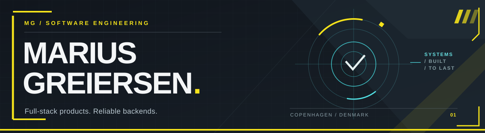

### Hi, I'm Marius.

I'm a **Computer Science master's student at the University of Copenhagen (DIKU)**. I build full-stack applications and backend systems, with a focus on clean architecture, correctness, and software that's useful to people.

**Interests:** Full-stack development · Backend engineering · Databases · Testing

[**Explore my projects**](#selected-projects) · [**Technology**](#technology) · [**All repositories**](https://github.com/mariusgreiersen?tab=repositories)

---

## Selected projects

### 01 / [JobFlow — Job Application Tracker](https://github.com/mariusgreiersen/jobflow-application-tracker)

A full-stack application for organizing job applications, interviews, and follow-ups. Includes a drag-and-drop pipeline, dashboards, analytics, and a no-login demo mode.

`Next.js` · `React` · `TypeScript` · `Supabase` · `Playwright`

**Engineering focus:** Clean Architecture, accessible UI, automated testing, and CI.

[View repository](https://github.com/mariusgreiersen/jobflow-application-tracker) · [Architecture notes](https://github.com/mariusgreiersen/jobflow-application-tracker/blob/main/docs/architecture.md)

### 02 / [BookingCore — Reservation API](https://github.com/mariusgreiersen/bookingcore-api)

A Java REST API for booking meeting rooms, designed to prevent double-bookings even when requests arrive concurrently.

`Java` · `Spring Boot` · `PostgreSQL` · `Docker` · `Testcontainers`

**Engineering focus:** Database-enforced consistency, concurrency testing, and reliable API design.

[View repository](https://github.com/mariusgreiersen/bookingcore-api)

---

## Technology

| Area | Tools |
| :--- | :--- |
| **Languages** | TypeScript, Java, SQL |
| **Frontend** | React, Next.js, Tailwind CSS |
| **Backend & data** | Spring Boot, REST APIs, PostgreSQL, Supabase |
| **Quality & tooling** | Git, Docker, GitHub Actions, Vitest, Playwright, Testcontainers |

## How I build

- **Useful first.** Software should solve a real problem and be easy to understand.
- **Correct by design.** Prefer clear boundaries, tests, and trustworthy data.
- **Details matter.** Performance, accessibility, and maintainability are part of the product.

---

Based in Denmark · [github.com/mariusgreiersen](https://github.com/mariusgreiersen)
